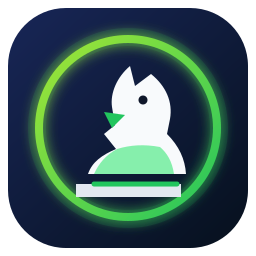

<div align="center">
  
  <h1>ChessLens</h1>
  <p><strong>A local-first chess training companion for Android.</strong></p>
  <p>
    
    
    
    
  </p>
  <p>
    <a href="#getting-started">Get started</a> ·
    <a href="#how-it-works">How it works</a> ·
    <a href="#safety--privacy">Safety & privacy</a> ·
    <a href="#known-limitations">Limitations</a> ·
    <a href="https://github.com/yangmetastasi104/ChessLens/releases">Releases</a>
  </p>
</div>

---

ChessLens is an **experimental training tool**. With your explicit training selection and Android’s screen-capture consent, it processes frames on-device, checks observed changes against legal chess moves, and can show a Stockfish suggestion in an overlay.

>  **Training only.** Do not use ChessLens during rated games, tournaments, or any activity where outside assistance is prohibited. Suggestions are disabled unless you affirm that the session is for permitted training.

## What it does

-  **Consent-gated capture.** Captures the screen only after Android’s per-session MediaProjection consent.
-  **Legal-move tracking.** Checks candidate board changes against a trusted, complete FEN and legal chess continuations.
-  **Bundled engine.** Runs Stockfish with matching NNUE networks on ARM64, ARMv7, x86, and x86_64 devices.
-  **Validated suggestions.** Accepts an engine move only after it passes the app’s legal-move generator.
-  **Local by design.** Processes frames in memory; nothing is uploaded or saved.
-  **Truthful failure.** Reports uncertainty or engine unavailability instead of inventing a position or evaluation.

## Getting started

### Download

The signed universal APK is published on the [Releases](https://github.com/yangmetastasi104/ChessLens/releases) page as [`chesslens-v1.1.0-universal-release.apk`](https://github.com/yangmetastasi104/ChessLens/releases/download/v1.1.0/chesslens-v1.1.0-universal-release.apk). It contains the Stockfish engine for every supported ABI, so the same file can be installed on ARM64, ARMv7, x86, and x86_64 devices running Android 5.0 (API 21) or newer. The published SHA-256 checksum is available alongside the APK.

Version 1.1.0 fixes the launcher icon, the Android 10+ engine execution failure, the overlay-to-screen coordinate mapping, and the floating panel. The panel is now larger, uses density-aware text, can be dragged, and can be resized from its bottom-right corner; its size and position are remembered between sessions. Recognition now tolerates a few uncertain squares by matching them against legal moves, and engine analysis is time-bounded so suggestions appear sooner.

The earlier `v1.0.0-debug` prerelease is a debug-signed ARM64 preview. Android will not install it over the release build (and vice versa) because the signing keys differ; uninstall the previous build before switching.

### Build

Requirements: JDK 17, Android SDK platform 35, and Android Build Tools 35.0.0.

```sh
./gradlew clean testDebugUnitTest assembleDebug
```

The debug APK is created at `app/build/outputs/apk/debug/app-debug.apk`.

To produce a signed release APK, create `keystore.properties` in the repository root with `storeFile`, `storePassword`, `keyAlias`, and `keyPassword`, then run:

```sh
./gradlew assembleRelease
```

The release APK is created at `app/build/outputs/apk/release/app-release.apk`. Keystore files and `keystore.properties` are ignored by git. Back up the keystore and its passwords securely: Android requires the same signing key for every future update of an installed app.

### Use for a training session

1. Open ChessLens and select **Training**.
2. Enter the complete six-field FEN for the board on screen.
3. Confirm that the visible board matches that FEN and select the board orientation.
4. Grant overlay permission if Android requests it, then approve the screen-capture prompt.
5. Keep the board stable while ChessLens calibrates. A suggestion appears only after a position is accepted and the engine’s move passes legal-move validation.
6. Drag the floating panel to move it. Drag its bottom-right corner to resize it; the app remembers the chosen size and position.

Select **Not training** or stop/revoke screen capture to end the session. ChessLens does not identify which app is visible and cannot verify that a venue permits assistance.

## How it works

```text
Explicit training choice + FEN confirmation
                    │
          Android capture consent
                    │
       On-device board recognition
                    │
    Legal continuation / uncertainty gate
                    │
       Stockfish UCI (ARM64 · ARMv7 · x86 · x86_64)
                    │
        Legal-move validation
                    │
        Optional screen overlay
```

The entered FEN supplies side-to-move, castling rights, en-passant square, and move counters. ChessLens cannot infer missing move history from pixels. If the game has been reset or the initial position was entered incorrectly, stop and begin again with a correct FEN.

## Platform and engine

ChessLens supports Android 5.0 (API 21) and newer. Android 4.4 and older cannot run the Compose UI stack used by the app and are not supported. The universal APK bundles four portable (`stockfish_nosimd`) UCI executables from F-Droid DroidFish 1.90, one for each Android ABI:

| ABI | Device type | Packaged native library |
| --- | --- | --- |
| `arm64-v8a` | 64-bit ARM phones and tablets | `lib/arm64-v8a/libstockfish.so` |
| `armeabi-v7a` | 32-bit ARM devices | `lib/armeabi-v7a/libstockfish.so` |
| `x86` | 32-bit Intel/AMD emulators and devices | `lib/x86/libstockfish.so` |
| `x86_64` | 64-bit Intel/AMD emulators and devices | `lib/x86_64/libstockfish.so` |

The engines are packaged as native libraries rather than assets so Android 10 and newer can execute the matching binary from the read-only native library directory; Android 10 blocks execution from writable app data. At install time Android extracts the ABI that matches the device. The engine runs with the private NNUE directory as its working directory, so Stockfish can load the networks without writing into the native library directory.

At runtime the app selects the first ABI reported by the device that has a bundled executable. If none matches, ChessLens reports that the engine is unavailable instead of substituting a fabricated evaluation or move. The corresponding source revision, Android build files, provenance, and GPL notice are under [`third_party/stockfish-droidfish-1.90/`](third_party/stockfish-droidfish-1.90/). The matching NNUE networks are included once in the app assets and shared by all four executables.

## Safety & privacy

- Suggestions are intended only for permitted training.
- Both an explicit in-app training confirmation and Android’s screen-capture consent are required.
- The app does not bypass platform controls or inspect app identity.
- Captured frames are processed locally in memory and are not uploaded or written to storage.
- Board recognition is uncertain by nature; a legal-move gate reduces some errors but does not guarantee correct visual interpretation.

## Known limitations

- Board detection assumes an axis-aligned board; perspective and tilt correction are not implemented.
- Piece recognition uses visual templates calibrated from the supplied position and may fail across themes, animations, occlusion, or unusual board colors. The legal-move gate can reconcile a small number of uncertain squares, but it cannot recover a board that is mostly unrecognized.
- If the panel reports uncertain squares, stop capture, enter the current visible FEN, and restart the session. ChessLens will not invent a position or a move.
- Special-move state depends on the supplied FEN and subsequent correctly tracked moves.
- The prototype has unit-test coverage but has **not** been validated for recognition accuracy, latency, or engine startup on a physical device.
- Android 5.0 and 5.1 grant the overlay permission at install time; Android 6.0 and newer require the user to grant it in Settings.
- The 32-bit ARM and x86 executables are slower than the 64-bit builds. On low-memory devices, loading the 65 MB NNUE network may be delayed or fail; ChessLens reports engine unavailability rather than inventing a result.
- The universal APK is large because it carries four engines and both NNUE networks. Android installs only one engine at runtime, but all assets are present in the package.

## Development

```sh
./gradlew testDebugUnitTest
./gradlew assembleDebug
```

## Third-party licensing

Stockfish is licensed under **GPL-3.0-or-later**. The applicable license, corresponding engine source, build files, and binary provenance are included in this repository. See [`third_party/stockfish-droidfish-1.90/README.md`](third_party/stockfish-droidfish-1.90/README.md) and [`Copying.txt`](third_party/stockfish-droidfish-1.90/Copying.txt).
